<!-- _class: compact -->
<!-- _class: title-clean -->

<!-- Slide 1 -->
# Estructura a Gran Escala del Universo
#### Explorando la grandeza del cosmos desde la Tierra y el espacio
<!-- : El universo de las galaxias y la Red Cósmica -->

### **Jorge Enrique García Farieta**
### Observatorio Astronómico <br> Universidad Nacional de Colombia

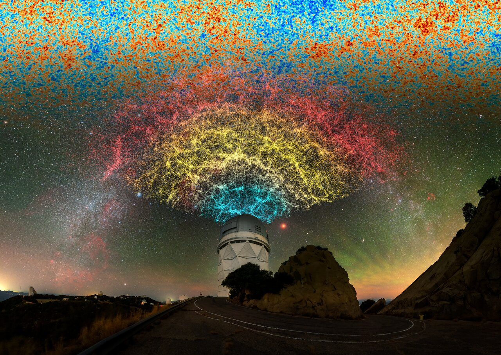

---

<!-- Slide 3 -->
# ¿Cosmología en el aula?

* **Alto Valor Motivacional:** Responde a las preguntas fundamentales del ser humano (*¿De dónde venimos? ¿Hacia dónde va el Universo?*).
* **Integración STEM:** Conecta mecánica newtoniana, óptica, ondas, espectroscopía, electromagnetismo y análisis de datos.
* **Naturaleza de la Ciencia:** Ejemplifica cómo la tecnología y la acumulación de datos modifican paradigmas teóricos.
* **Pensamiento Crítico:** Desafía la intuición mediante la confrontación con escalas abstractas y conceptos no euclidianos.

---

<!-- _class: compact -->

## 🌌 Distancias Cósmicas

$$
\begin{array}{cccccccc}
1\,\mathrm{m} & 10^3\,\mathrm{m} & 10^6\,\mathrm{m} & 10^9\,\mathrm{m} & 10^{12}\,\mathrm{m} & 10^{16}\,\mathrm{m} & 10^{20}\,\mathrm{m} & 10^{26}\,\mathrm{m} \\
\text{Humano} & \text{Ciudad} & \text{Planeta} & \text{Luna} & \text{Sol} & \text{Estrellas} & \text{Galaxias} & \text{Cosmos} \\
\downarrow & \downarrow & \downarrow & \downarrow & \downarrow & \downarrow & \downarrow & \downarrow \\
\text{🚶} & \text{🏙️} & \text{🌍} & \text{🌙} & \text{☀️🪐} & \text{✦} & \text{🌌} & \text{∞}
\end{array}
$$

[EscaleraDistancias](https://www.youtube.com/watch?v=8Are9dDbW24) 

[](https://www.youtube.com/watch?v=8Are9dDbW24)

Source: <https://www.youtube.com/watch?v=8Are9dDbW24>

---

## 🌌 Distancias Cósmicas

<div style="display: flex; justify-content: center; align-items: center; width: 100%; height: 75%;">
  <iframe 
    src="https://scaleofuniverse.com/es-es" 
    width="100%" 
    height="100%" 
    style="border: 2px solid #ccc; border-radius: 8px; background: white;"
    allowfullscreen>
  </iframe>
</div>

---

<!-- Slide 13 -->
# Unidades de Distancia

Para evitar números inmanejables, en astrofísica y cosmología empleamos:

1. **Unidad astronómica (UA):** Distancia promedio de la Tierra al Sol: $149 597 870 700$ m (cerca de 150 millones de kilómetros).
2. **Año Luz (al):** Distancia recorrida por la luz en el vacío en un año juliano.
   $$1 \text{ al} \approx 9.461 \times 10^{15} \text{ m}$$
3. **Parsec (pc):** Distancia a la cual una unidad astronómica subtiende un ángulo de un segundo de arco ($1''$).
   $$1 \text{ pc} \approx 3.2616 \text{ al} \approx 3.086 \times 10^{16} \text{ m}$$
   $$1 \text{ Mpc} = 10^6 \text{ pc}, \quad 1 \text{ Gpc} = 10^9 \text{ pc}$$

---

### Unidad astronómica

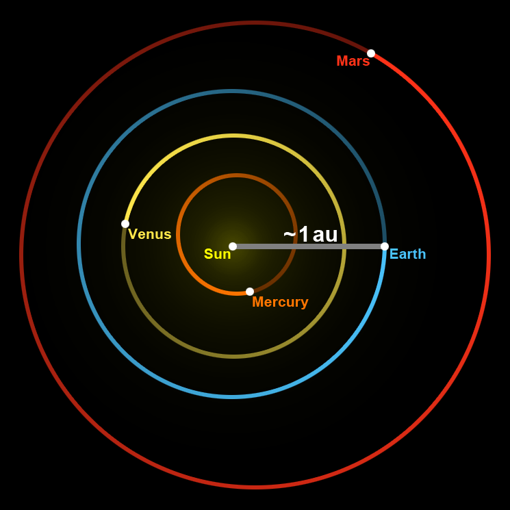

---

<div class=equation>

$$
\Large{d=vt}~~~~~~~~~~~~~~~~v=c=3\times10^8\,\mathrm{m/s}
$$

</div>

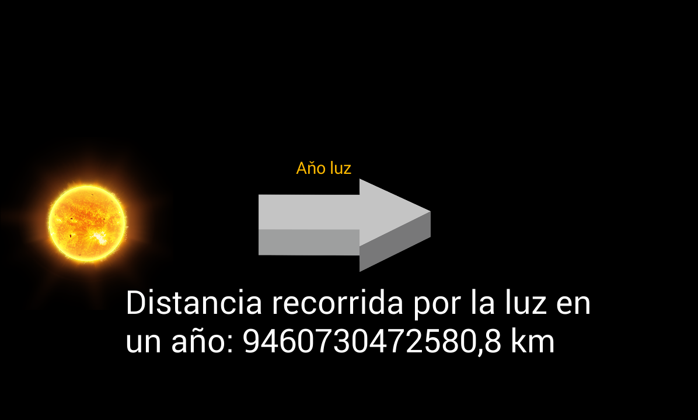

---

<div style="position: absolute; top: 0; left: 0; width: 100%; height: 100%; display: flex; justify-content: center; align-items: center;">
  <iframe
    src="https://www.desmos.com/scientific"
    width="100%"
    height="100%"
    sandbox="allow-scripts allow-same-origin allow-forms allow-popups"
    referrerpolicy="no-referrer"
    loading="lazy"
    style="border: none; border-radius: 0; background: white;"
    allowfullscreen>
  </iframe>
</div>

---

<!-- _class: compact -->
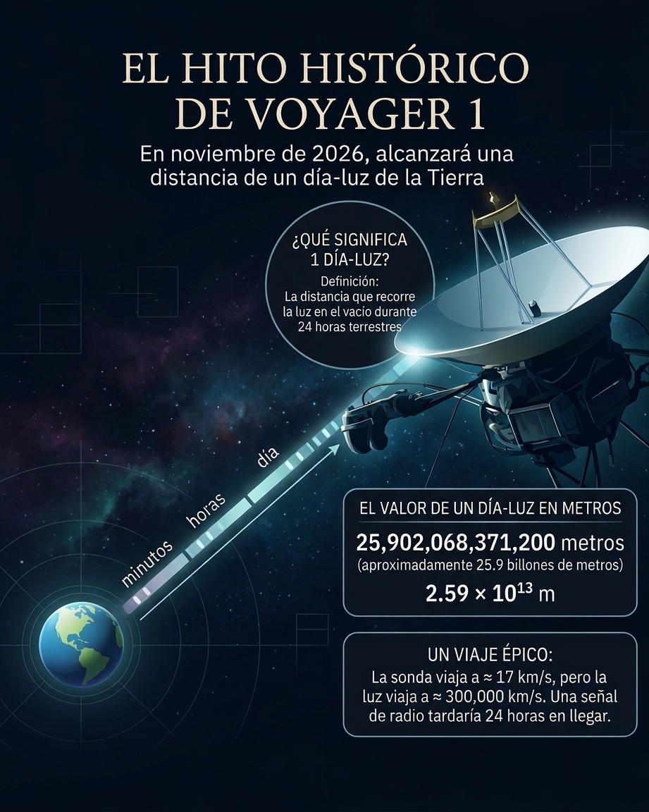

**Día luz: ~25902 millones de kilómetros**.

> *Noviembre 2026:* La sonda Voyager 1 cruza este umbral histórico, convirtiéndose en el primer objeto humano en situarse a más de 1 día luz de la Tierra.

<div class=equation>

$$d = 299792.458 \text{ km/s} \cdot 86.400 \text{ s}$$

$$\boxed{\Large d = 25902068371 \text{ km}}$$

<div>

<br>

* **Tiempo de ida y vuelta:** Cualquier comando enviado a la Voyager 1 tarda **24 horas** en llegar. Su respuesta tarda **otras 24 horas** en regresar.
* **Ciclo de comunicación:** Se requiere un total de **48 horas** para confirmar que la sonda recibió una orden.
* **Próximo hito:** La Voyager 2 (en una ruta más lenta) alcanzará su propio día luz de distancia en **noviembre de 2035**.

---

## Definición Geométrica del Parsec (pc)

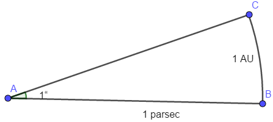

---

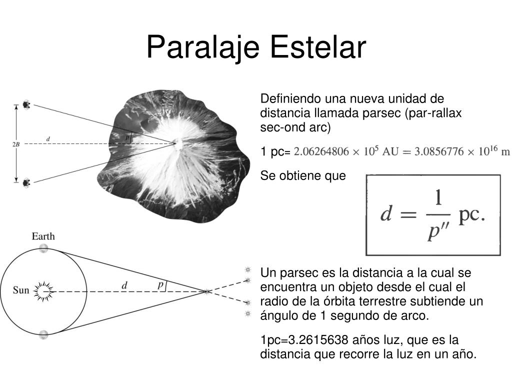

---

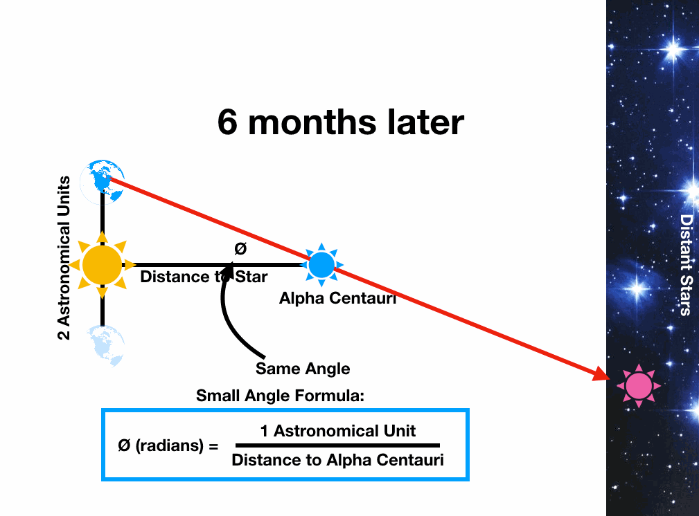

---

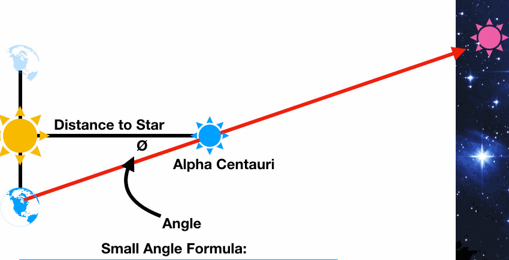

---

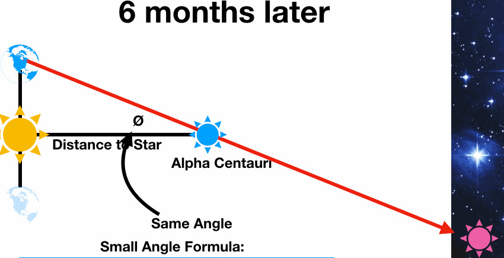

---

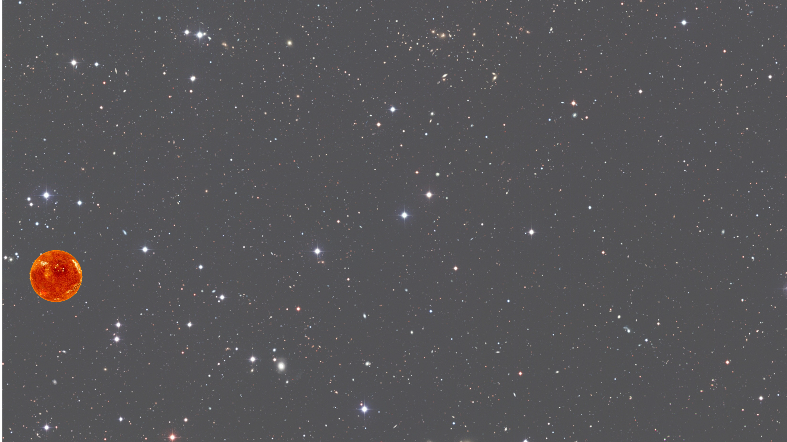

---

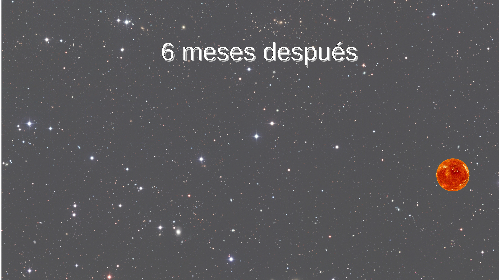

---

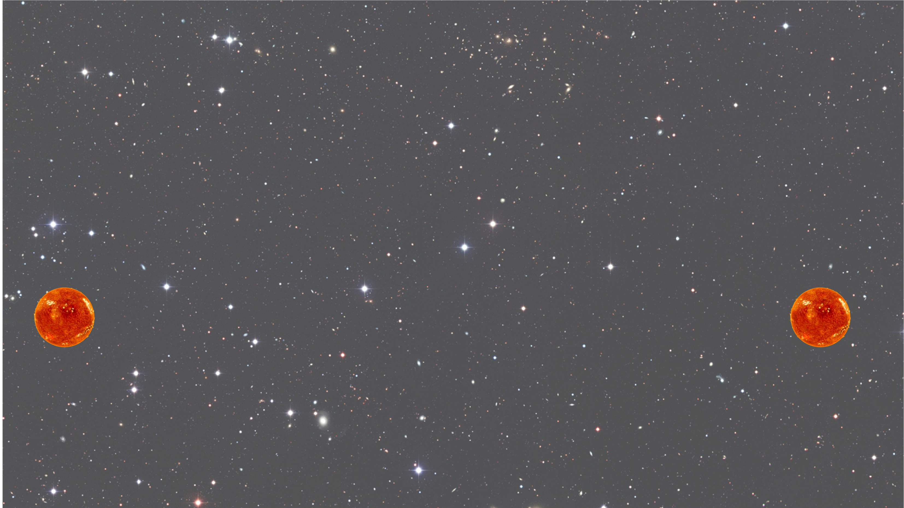

---

## 🌌 Distancias Cósmicas: Espectros y Ley de Hubble

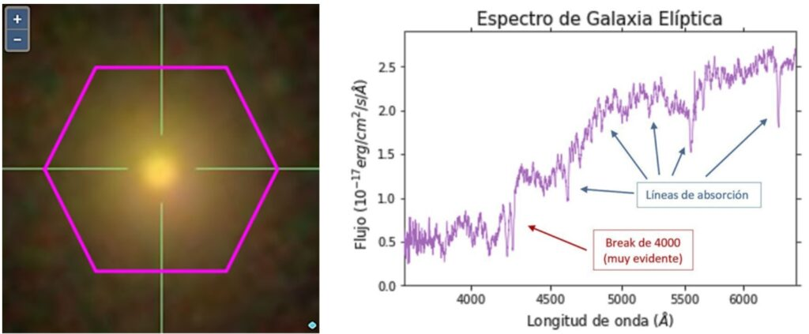


<br><br><br><br><br><br><br><br><br>
Espectro ➡️ Huella Química ➡️ Redshift ($z$) ➡️ Velocidad-Distancia 

---

<!-- Slide 8 -->
## 🌌 Distancias Cósmicas

Para comprender la Estructura a Gran Escala, debemos situar las dimensiones físicas en perspectiva logarítmica:

* **Sistema Solar:** $\sim 10^{13} \text{ m} \quad (\sim 100 \text{ UA})$
* **Vía Láctea:** $\sim 10^{21} \text{ m} \quad (\sim 30 \text{ kpc} \approx 100,000 \text{ al})$
* **Grupo Local:** $\sim 10^{22} \text{ m} \quad (\sim 1 \text{ Mpc})$
* **Cúmulo de Virgo / Supercúmulos:** $\sim 10^{24} \text{ m} \quad (\sim 30 \text{ Mpc})$
* **Red Cósmica / Universo Observable:** $\sim 10^{26} \text{ m} \quad (\sim 14 \text{ Gpc} \approx 46.5 \text{ Gly})$

---

<!-- _class: compact -->

# El problema de medir el Universo

Los kilómetros funcionan muy bien… hasta que las distancias dejan de ser humanas.

<div class="columns">
<div>

### Distancias características

| Escala | Distancia típica | Imagen |
|---|---:|:---:|
| Persona | ~1 m | 🚶 |
| Ciudad | ~10³–10⁴ m | 🏙️ |
| Tierra | ~10⁷ m | 🌍 |
| Sistema Solar | ~10¹³ m | ☉ ··· 🪐 |
| Estrellas | ~10¹⁶–10¹⁷ m | ✦ |
| Galaxias | ~10²¹ m | 🌌 |

</div>
<div>

### Unidades astronómicas

| Escala | Unidad | Aproximadamente |
|:---|:---:|---:|
| Sistema Solar | **UA** | $1.496\times10^{11}\,\mathrm{m}$ |
| Estrellas | **año luz** | $9.46\times10^{15}\,\mathrm{m}$ |
| Estrellas / Galaxia | **pc** | $3.09\times10^{16}\,\mathrm{m}$ |
| Galaxia | **kpc** | $3.09\times10^{19}\,\mathrm{m}$ |
| Galaxias | **Mpc** | $3.09\times10^{22}\,\mathrm{m}$ |
| Cosmología | **Gpc** | $3.09\times10^{25}\,\mathrm{m}$ |

</div>
</div>

<style>
.columns {
  display: grid;
  grid-template-columns: 1fr 1fr;
  gap: 28px;
  align-items: start;
}
.columns table {
  width: 100%;
  font-size: 0.68em;
}
.columns th,
.columns td {
  padding: 7px 5px;
}
</style>

$$
\boxed{
\mathrm{m}\rightarrow
\mathrm{UA}\rightarrow
\mathrm{ly}\rightarrow
\mathrm{pc}\rightarrow
\mathrm{kpc}\rightarrow
\mathrm{Mpc}\rightarrow
\mathrm{Gpc}
}
$$

---

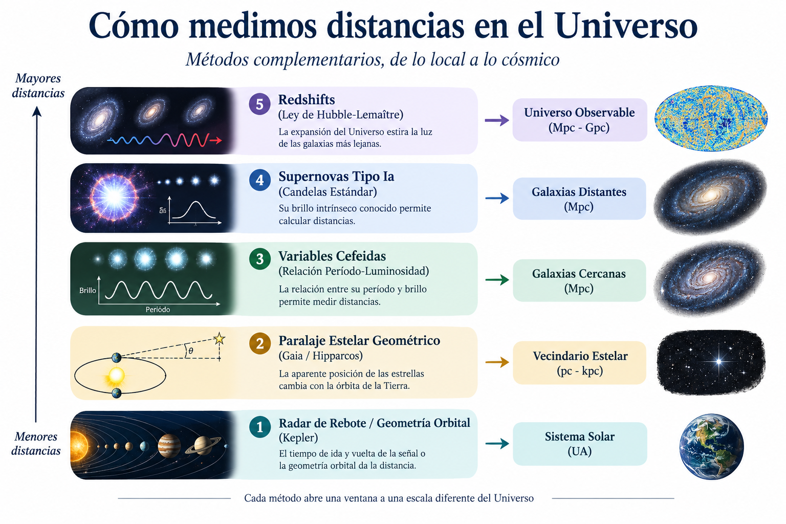

---

## ¿Cuánto mide el cielo?

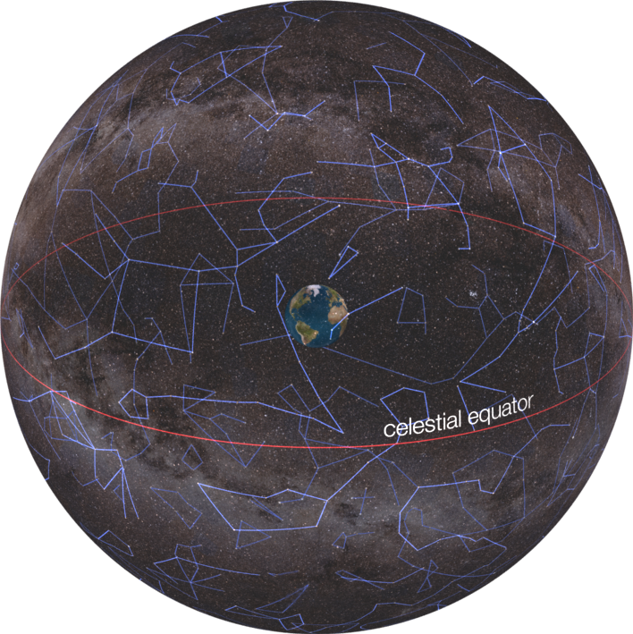

El cielo parece una superficie plana cuando lo observamos, pero en realidad lo representamos sobre una esfera imaginaria.

- Una vuelta completa tiene 360°.
- El cielo completo corresponde a una esfera.
- Para medir áreas sobre una esfera usamos el **ángulo sólido**.

---


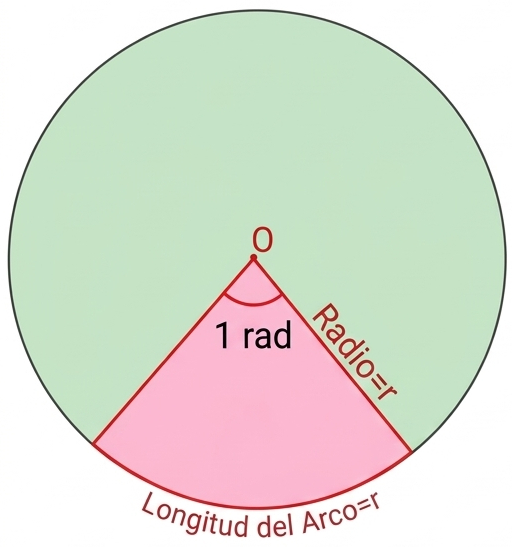
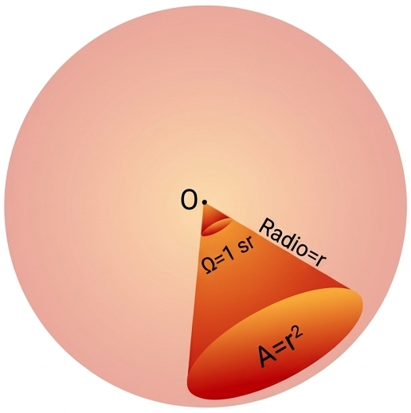

| Longitud de arco | Área sobre una esfera |
|:---:|:---:|
| $S=r\theta$ | $A=r^2\color{red}{\Omega}$ |

Área de una esfera es $A=4\pi r^2$:

$$r^2\Omega=4\pi r^2
\quad\Longrightarrow\quad
\boxed{{\color{red}{\Omega}} = 4\pi\ \text{sr}}$$

**Grados cuadrados:**

Como $1\ sr=(180/\pi)^2\ deg^2$:

$$
\Omega_{\text{cielo}}=
4\pi\left(\frac{180}{\pi}\right)^2
$$

$\boxed{\Omega_{\text{cielo}}\approx 41253\ deg^2}$

<!-- ¡El cielo completo ocupa 4π estereorradianes o 41 253 grados cuadrados! -->

<!-- https://www.fizzics.org/steradian/ -->
<!-- https://www.youtube.com/watch?v=7f89vZEn9xw -->

---

[Superficie de una esfera](https://www.youtube.com/watch?v=GNcFjFmqEc8) 

[](https://www.youtube.com/watch?v=GNcFjFmqEc8)

🎥 <https://www.youtube.com/watch?v=GNcFjFmqEc8>

---

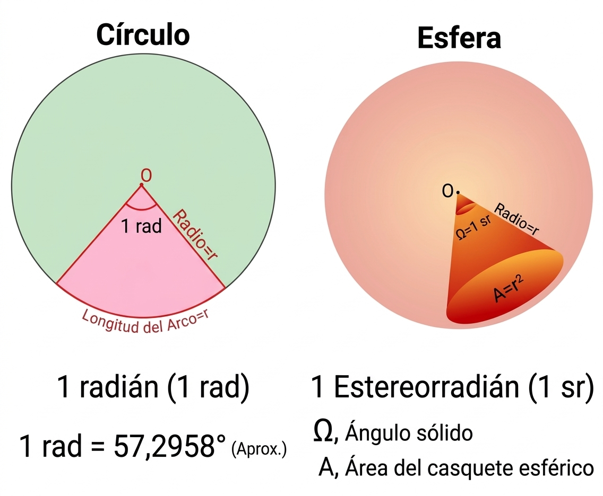

---

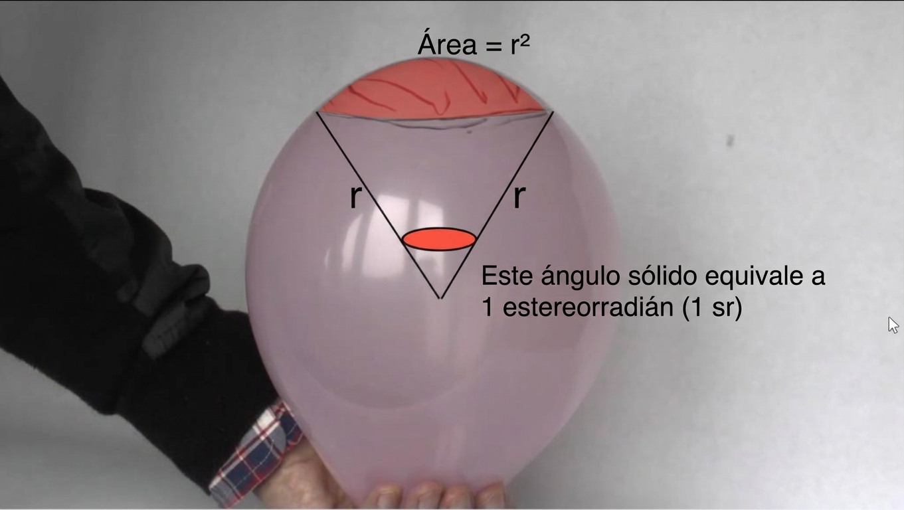

---

<!-- _class: compact -->

<div style="display:grid; grid-template-columns:1fr 1fr; gap:10px; height:500px;">
  <div style="display:grid; gap:10px;">
    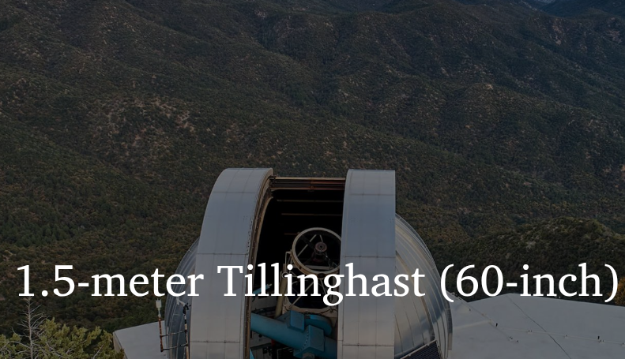
    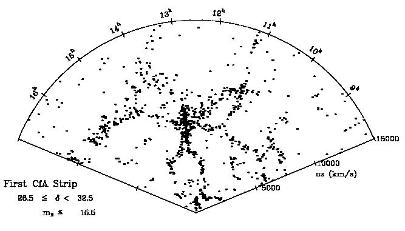
  </div>
  
</div>

---

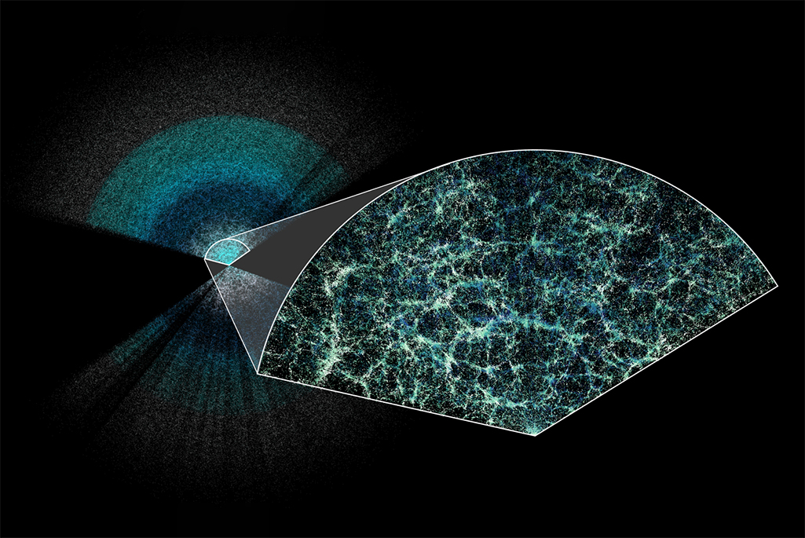

---

<div style="position: absolute; top: 0; left: 0; width: 100%; height: 100%; display: flex; justify-content: center; align-items: center;">
  <iframe
    src="https://www.astronomy.com/science/untangling-the-cosmic-web/"
    width="100%"
    height="100%"
    sandbox="allow-scripts allow-same-origin allow-forms allow-popups"
    referrerpolicy="no-referrer"
    loading="lazy"
    style="border: none; border-radius: 0; background: white;"
    allowfullscreen>
  </iframe>
</div>

---

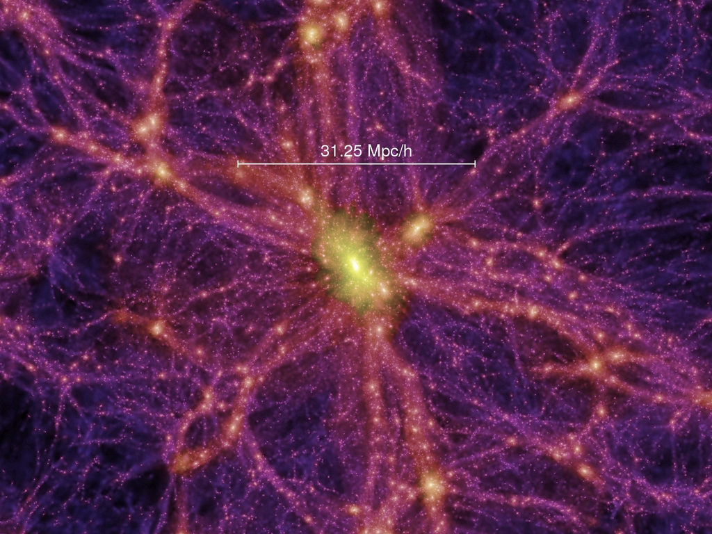

---

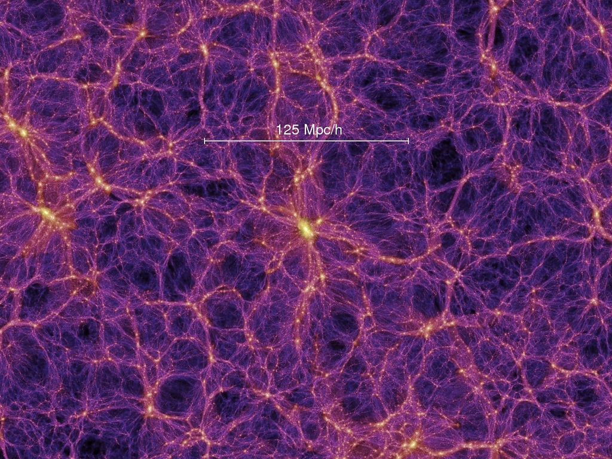

---

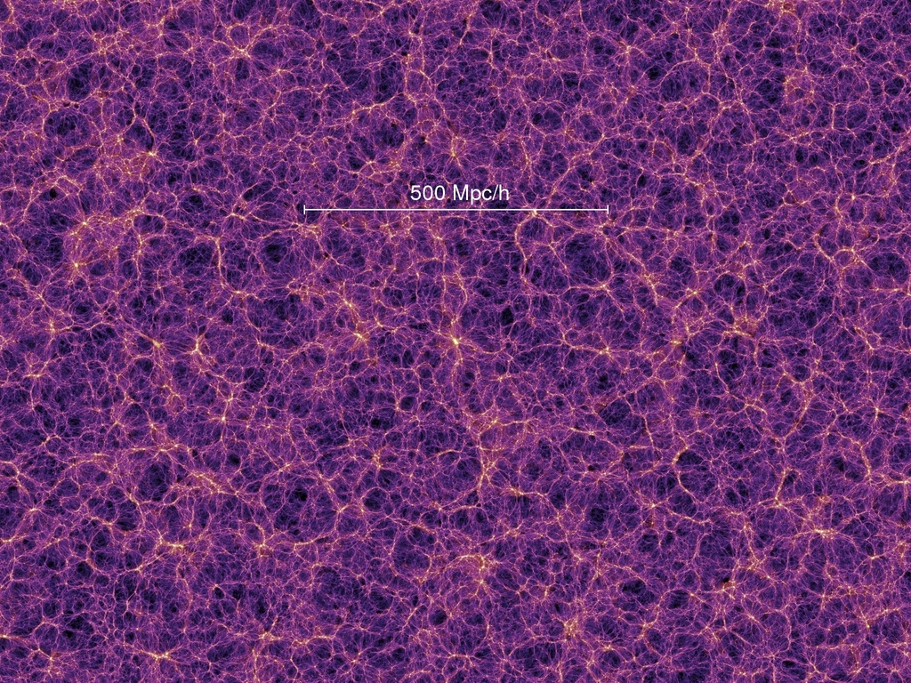

---

# Simulación Millennium

<video controls width="100%" height="100%" playsinline>
  <source src="./img/millennium_sim_1024x768.mp4" type="video/mp4">
</video>

---

<!-- Slide 4 Laboratorio Cósmico -->
# Estructura a Gran Escala 

* **El Universo como Experimento Único:** A gran escala no podemos manipular variables en laboratorio, solo observar y modelar.
* **Dominio Gravitacional:** En escalas $>10 \text{ Mpc}$, la gravedad es la interacción dominante que moldea la materia.
* **Ventana al Pasado:** Debido a la velocidad finita de la luz, observar grandes distancias equivale a explorar épocas tempranas del Cosmos (*Lookback Time*).

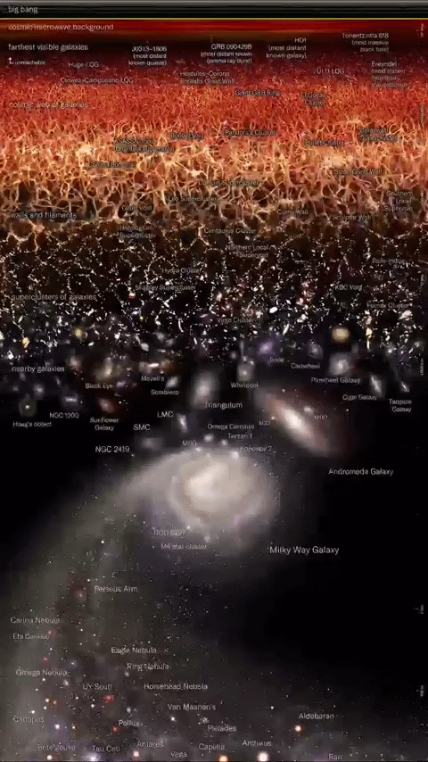

---

<!-- _class compact -->
<!-- Slide 6 -->
# Estructura a Gran Escala 

<div class=highlight>

"Para entender la estructura a gran escala del universo, es fundamental comprender la gravedad. A pesar de ser la más débil de las cuatro fuerzas fundamentales, es aditiva y de largo alcance, lo que le permite dominar el cosmos a gran escala."

</div>

*Construir una explicación de la teoría del Big Bang basada en evidencia astronómica de espectros de luz, movimiento de galaxias distantes y composición de la materia en el universo.*

* **Desafío: el espacio como contenedor estático**
* **Efecto Doppler vs. Expansión** 

<!-- 
* **Desafío Didáctico:** El espacio como contenedor estático.
* **Efecto Doppler vs. Expansión:** Se asume que las galaxias se desplazan *a través* del espacio mediante un impulso cinético ordinario, ignorando el comportamiento métrico del tejido cósmico.
* **Estrategia:** Transición guiada desde observaciones concretas (espectros) hacia modelos métricos abstractos (factor de escala $a(t)$).
 -->

---

<!-- Slide 9 -->
## Escala 1: Entorno Galáctico Local

* **Galaxia:** Sistema masivo ligado gravitacionalmente compuesto por estrellas, gas, polvo y materia oscura.
* **Nuestra Galaxia:**
  * Galaxia espiral barrada con un diámetro de $\approx 30 \text{ kpc}$.
  * Alberga entre $100000$ - $400000$ millones de estrellas.
  * El Sistema Solar se ubica a $\approx 8 \text{ kpc}$ del centro galáctico.

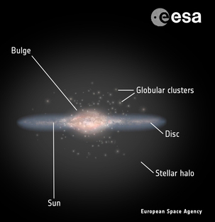

---

<!-- Slide 10 -->
## Escala 2: Grupos y Cúmulos de Galaxias

* **Grupo Local:**
  * Conjunto de $>80$ galaxias dominado por la Vía Láctea y Andrómeda (M31).
  * Dimensión de $\approx 3 \text{ Mpc}$.
* **Cúmulos de Galaxias (Galaxy Clusters):**
  * Las estructuras ligadas gravitacionalmente más masivas del Universo ($10^{14} - 10^{15} M_\odot$).
  * Ejemplos: Cúmulo de Virgo, Cúmulo de Coma.
  * Compuestos por galaxias ($5\%$), gas caliente intracúmulo en rayos X ($15\%$) y Materia Oscura ($80\%$).

---

<!-- Slide 11 -->
<!-- _class: compact -->
## Escala 3: Supercúmulos y Red Cósmica

➡️ **Supercúmulos:**
  * Grandes agrupaciones de cúmulos y grupos de galaxias que abarcan decenas de Megaparsecs.
  * Nuestro hogar: El Supercúmulo **Laniakea** ($\sim 160 \text{ Mpc}$).

➡️ **Transición a Gran Escala:**
  * A escalas superiores a $\sim 100 \text{ Mpc}$, los supercúmulos dejan de estar gravitacionalmente aislados y forman un patrón interconectado continuo.

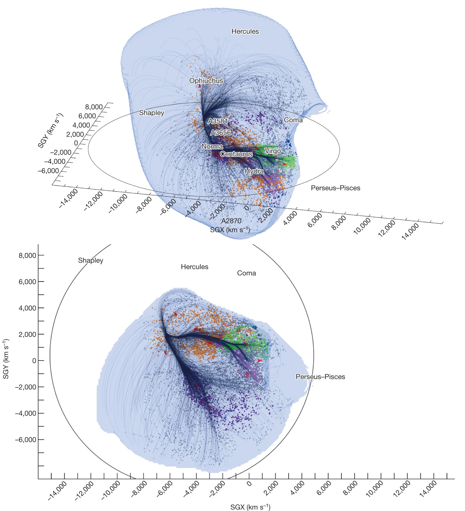

---

<div style="position: absolute; top: 0; left: 0; width: 100%; height: 100%; display: flex; justify-content: center; align-items: center;">
  <iframe
    src="https://universemap.net/laniakea-supercluster-3d-map/"
    width="100%"
    height="100%"
    sandbox="allow-scripts allow-same-origin allow-forms allow-popups"
    referrerpolicy="no-referrer"
    loading="lazy"
    style="border: none; border-radius: 0; background: white;"
    allowfullscreen>
  </iframe>
</div>

---

<!-- Slide 12 -->
## Escala 4: El Universo Observable

* **Universo Observable:** Esfera centrada en el observador delimitada por la distancia que la luz ha podido viajar desde el Big Bang ($13.8$ mil millones de años).
* **Distancia Comóvil al Horizonte:** Radio actual de $\approx 46.5$ mil millones de años luz ($\approx 14.3 \text{ Gpc}$) debido a la expansión métrica del espacio.
* **Contenido Estimado:** Se calcula que contiene más de 2 billones ($2 \times 10^{12}$) de galaxias.

---

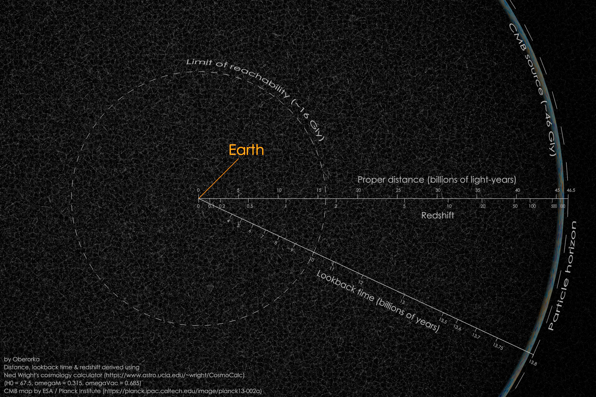

---

<!-- _class: center -->
# Desafíos ⁉️

### ➡️ Medir distancia cosmológicas
### ➡️ Composición del universo

---

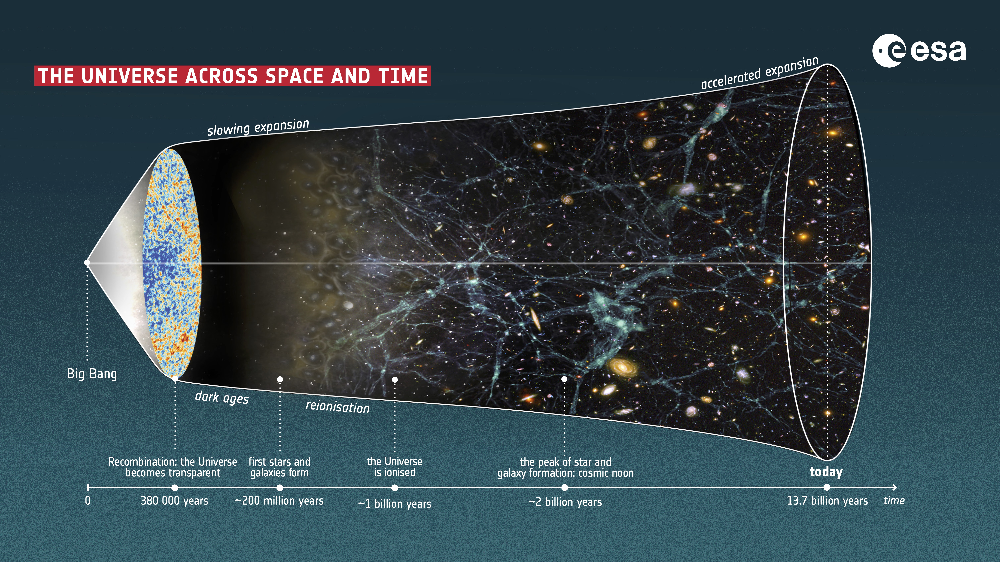

---

<!-- Slide 16 -->
# El Principio Cosmológico

Base fundamental de la cosmología física moderna:

<div class="highlight">

A escalas suficientemente grandes ($\sim 100 \text{ Mpc}$), el Universo es <b>Homogéneo</b> e <b>Isotrópico</b>."

</div>

* **Homogeneidad:** Las propiedades físicas del Universo son idénticas en cualquier punto del espacio (no hay posiciones privilegedas).
* **Isotropía:** El Universo luce idéntico en todas las direcciones de observación (no hay direcciones privilegiadas).
* **Consecuencia:** Eliminación del geocentrismo y antropocentrismo.

---

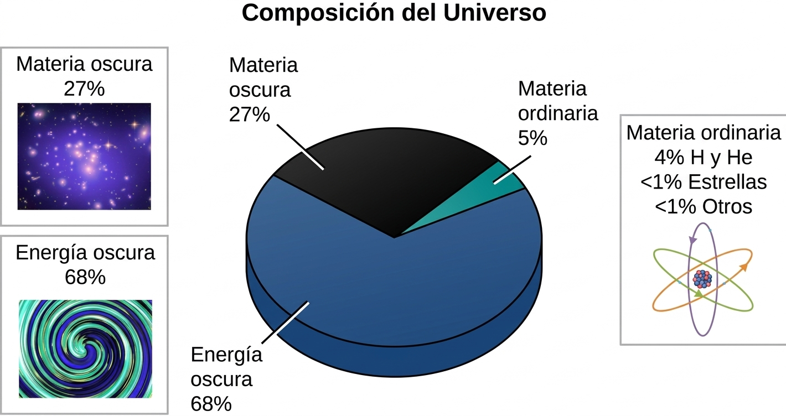

---

## El Inventario Energético del Cosmos ($\Lambda\text{CDM}$)

Según los datos de precisión actuales (Sondeo Planck, WMAP, SDSS, DESI):

* **Materia Bariónica (Ordinaria):** $\approx 4.9\%$ (Átomos, estrellas, planetas, gas).
* **Materia Oscura Fría (CDM):** $\approx 26.8\%$ (Materia no bariónica invisible).
* **Energía Oscura ($\Lambda$):** $\approx 68.3\%$ (Responsable de la aceleración cosmológica).

<div class="highlight">

<b>Conclusión asombrosa:</b> ¡El $95\%$ del Universo está compuesto por ingredientes oscuros desconocidos en el Modelo Estándar de física de partículas!

</div>

---

<!-- Slide 14 -->
## Velocidad de la Luz y Tiempo de Mirada Atrás

* **Velocidad Finita de la Luz:** $c \approx 300000 \text{ km/s}$.
* **Tiempo de Mirada Atrás (*Lookback Time*):**
  * Cuando observamos la Galaxia de Andrómeda ($2.5 \text{ Mly}$), la vemos como era hace $2.5$ millones de años.
  * Al observar galaxias a $z = 2$, la luz emitida tardó más de $10$ mil millones de años en llegar a nuestros telescopios.

<div class="highlight">
<b>Principio clave:</b> Mirar profundo en el espacio es viajar hacia atrás en el tiempo cosmológico.
</div>

---

<!-- _class: compact -->
## Luz y Espectroscopía: El Lenguaje Cósmico

*Como no podemos viajar a las galaxias, la luz es nuestra única fuente de información.*

* **Espectroscopía:** Descomposición de la luz en sus longitudes de onda ($\lambda$).
* **Líneas Espectrales:** Transiciones electrónicas de átomos en las atmósferas estelares y gas intergaláctico que actúan como "huellas dactilares" químicas.

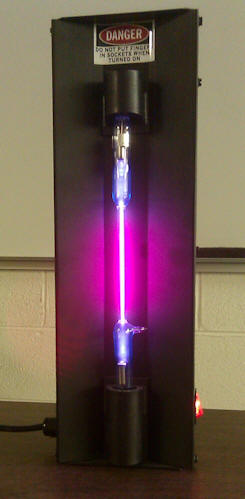

---

<!-- _class: compact -->
<div style="display:grid; grid-template-columns:1fr 1fr; gap:0; height:500px;">
<div style="display:grid; grid-template-rows:350px 350px; gap:0;">
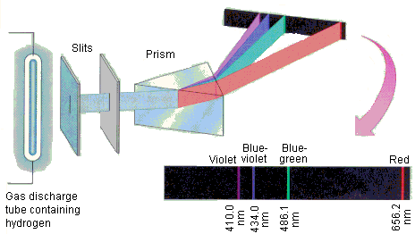
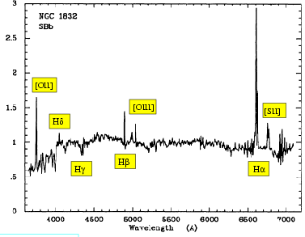
</div>

</div>

---

* **1. Captura del Espectro:** Se descompone la luz de la galaxia mediante un espectrógrafo.
* **2. Huella Química:** Se identifican las líneas de absorción/emisión de elementos conocidos.
* **3. Cálculo del Redshift ($z$):** Se mide el desplazamiento relativo de las líneas hacia el rojo.
  $$z = \frac{\lambda_{\text{observada}} - \lambda_{\text{reposo}}}{\lambda_{\text{reposo}}}$$
* **4. Velocidad y Distancia:** Se aplica el efecto Doppler ($v \approx z \cdot c$) y la expansión métrica:
  $$v = H_0 \ d \implies d \approx \frac{v}{H_0}= \frac{cz}{H_0}$$

---

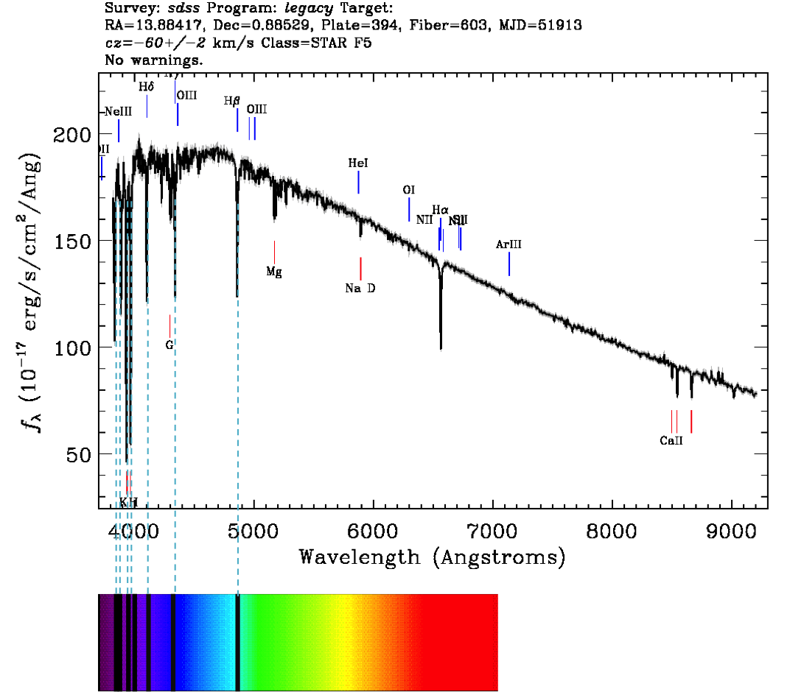

---

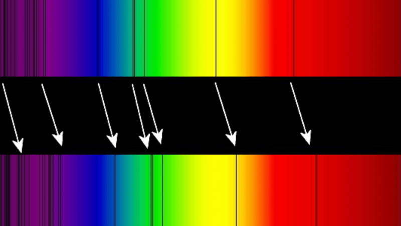

---

<!-- _class: compact -->
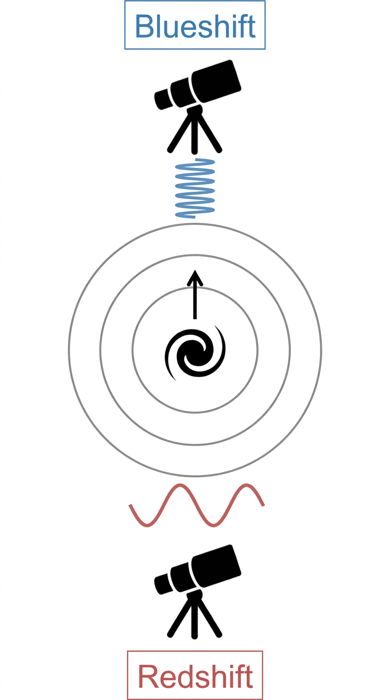

## Doppler vs. Corrimiento al Rojo Cosmológico

Es crucial distinguir dos fenómenos:

1. **Efecto Doppler (Velocidad Peculiar):**
   * Movimiento real de una galaxia *a través* del espacio local debido a atracciones gravitacionales adyacentes.
2. **Corrimiento al Rojo Cosmológico (Redshift $z$):**
   * Estiramiento de la longitud de onda de los fotones durante su viaje debido a la **expansión métrica del espacio mismo**.

---

## Doppler vs. Corrimiento al Rojo Cosmológico

<video controls width="100%" height="100%" playsinline>
  <source src="./img/Doppler2.mp4" type="video/mp4">
</video>

---

## Cálculo de redshift de una galaxia

```SQL
SELECT TOP 10
   p.objid,p.ra,p.dec,p.u,p.g,p.r,p.i,p.z,
   p.run, p.rerun, p.camcol, p.field,
   s.specobjid, s.class, s.z as redshift,
   s.plate, s.mjd, s.fiberid
FROM PhotoObj AS p
   JOIN SpecObj AS s ON s.bestobjid = p.objid
WHERE 
   p.u BETWEEN 0 AND 19.6
   AND g BETWEEN 0 AND 20
```

<div style="text-align: center; margin-top: 2em;">
  <a href="https://skyserver.sdss.org/dr16/en/tools/search/sql.aspx" 
     target="_blank" 
     rel="noopener"
     style="
       display: inline-block;
       padding: 0.7em 1.2em;
       background: #1e88e5;
       color: white;
       text-decoration: none;
       border-radius: 6px;
       font-weight: 600;
       border: 2px solid #1565c0;
     ">
    Skyserver SDSS DR16
  </a>
</div>

---

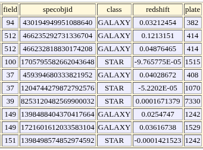

---

| field | specobjid | class | redshift | plate |
| --- | --- | --- | --- | --- |
| 94 | 430194949951088640 | GALAXY | 0.03212454 | 382 |
| 512 | 466235292731336704 | GALAXY | 0.1213151 | 414 |
| 512 | 466232818830174208 | GALAXY | 0.04876465 | 414 |
| 100 | 1705795582662043648 | STAR | -9.765775E-05 | 1515 |
| 37 | 459394680333821952 | GALAXY | 0.04028672 | 408 |
| 149 | 1398488404370417664 | GALAXY | 0.0254747 | 1242 |
| 149 | 1721601612033583104 | GALAXY | 0.03616738 | 1529 |
| 151 | 1398498574852974592 | STAR | -0.0001421523 | 1242 |

---

<div style="position: absolute; top: 0; left: 0; width: 100%; height: 100%; display: flex; justify-content: center; align-items: center;">
  <iframe
    src="https://specdash.idies.jhu.edu/"
    width="100%"
    height="100%"
    sandbox="allow-scripts allow-same-origin allow-forms allow-popups"
    referrerpolicy="no-referrer"
    loading="lazy"
    style="border: none; border-radius: 0; background: white;"
    allowfullscreen>
  </iframe>
</div>

---

## Ley de Hubble-Lemaître

En 1929, Edwin Hubble (junto al trabajo teórico previo de Georges Lemaître) confirmó que las galaxias se alejan con una velocidad proporcional a su distancia:

<div class="formula">

$$\boxed{v = H_0 \cdot d}$$

</div>

* $v$: Velocidad de recesión ($\text{km/s}$).
* $d$: Distancia a la galaxia ($\text{Mpc}$).
* $H_0$: Parámetro de Hubble ($\approx 70 \text{ km/s/Mpc}$).

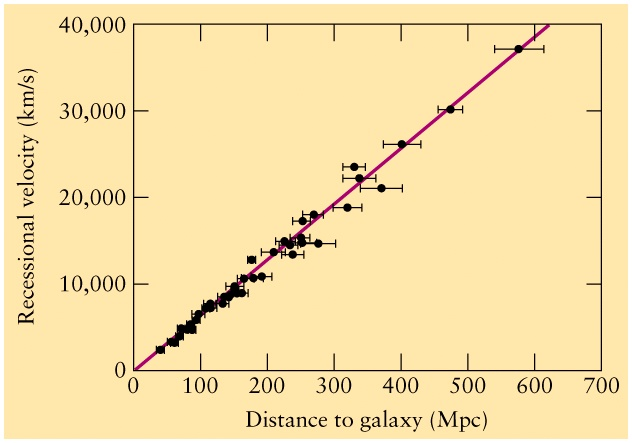

---
<!-- _class: compact -->

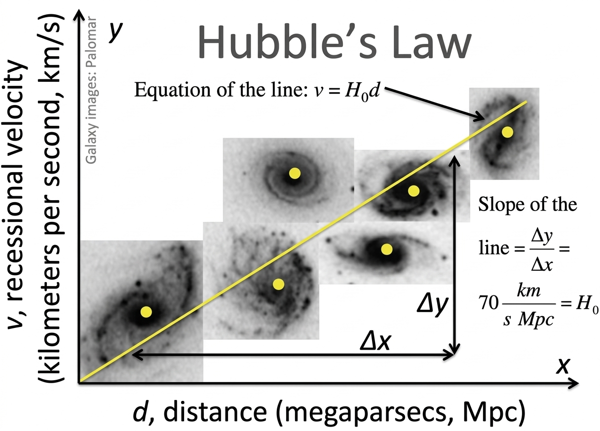

---

## Interpretación del parámetro de Hubble $H_0$

* **Significado Físico:** Indica la tasa actual de expansión del Universo.
* **Tiempo de Hubble ($T_H$):**
  * Si la expansión fuera constante, la edad aproximada del Cosmos se calcula como el inverso de $H_0$:
  <div class="formula">

  $$T_H = \frac{1}{H_0} \approx \frac{1}{70 \text{ km/s/Mpc}} \approx 13.9 \text{ mil millones de años}$$

  </div>
* Excelente concordancia de orden de magnitud con la edad derivada por la astrofísica estelar.

---

<!-- _class: compact -->
## La Estructura a Gran Escala: La Red Cósmica

* A escalas de cientos de Megaparsecs, la materia no se distribuye al azar ni de forma uniforme.
* La distribución adopta una arquitectura intrincada conocida como la **Red Cósmica** (*Cosmic Web*):
  1. **Filamentos**
  2. **Nodos (Cúmulos)**
  3. **Paredes / Láminas**
  4. **Vacíos Cósmicos (*Voids*)**

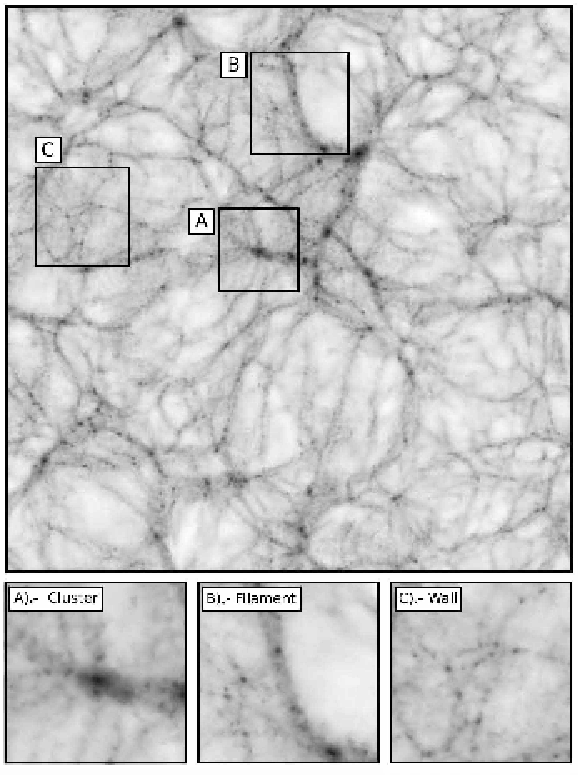

---

[The Cosmic Web Explained](https://www.youtube.com/watch?v=7V0WglxhhrQ) 

[](https://www.youtube.com/watch?v=7V0WglxhhrQ)

🎥 <https://www.youtube.com/watch?v=7V0WglxhhrQ>

---

## Cartografiando el Cosmos: Muestreos Espectroscópicos

Para construir mapas tridimensionales de la Red Cósmica necesitamos medir coordenadas en el cielo ($\alpha, \delta$) y distancia vía redshift ($z$):

```
       Fotometría 2D                    Espectroscopía 1D                  Mapa 3D del Universo
(Ángulo en el Cielo: RA, Dec)  +  (Corrimiento al Rojo: Redshift z)  =>  (Estructura a Gran Escala)
```

* **Grandes Telescopios de Cartografiado:** 

| # | Survey | Generación / estado | Resolución espectral (R) | Área (deg²) | Rango de redshift |
| --- | --- | --- | --- | --- | --- |
| 1 | DESI | 2021–presente | 2,000–5,500 | \~14,000 | 0–4 |
| 2 | Euclid | 2023–presente | \~380 | \~14,000 | 0.9–1.8 |
| 3 | 4MOST | Nueva generación | 5,000 / 20,000 | \~15,000 | Variable |
| 4 | PFS | Nueva generación | 2,300–5,000 | \~1,400 | 0.6–2.4 |
| 5 | WEAVE | Nueva generación | 5,000 / 20,000 | \~10,000 | Variable |
| 6 | Roman | Próxima generación | Variable | \~2,000\* | \~1–3 |
| 7 | MOONS | Nueva generación | Variable | Variable | \~0.5–6+ |
| 8 | SDSS-V | 2020–presente | \~2,000 | \~14,000 | Variable |
| 9 | WAVES | Nueva generación | Variable | \~1,000 | 0–0.8 |
| 10 | LAMOST | 2011–presente | \~1,800 / 7,500 | \~20,000+ | Variable |
| 11 | VIPERS | Completado | \~220 | \~24 | 0.5–1.2 |
| 12 | GAMA | Completado | Variable | \~286 | 0–0.5 |
| 13 | VVDS | Completado | \~230 | \~1 | 0–5 |
| 14 | DEEP2 | Completado | \~6,000 | \~2.8 | 0.7–1.4 |
| 15 | LEGA-C | Completado | \~3,500 | \~1.6 | 0.6–1.0 |
| 16 | MOSDEF | Completado | \~3,000–3,600 | \~0.05 | 1.4–3.8 |
| 17 | FMOS-COSMOS | Completado | \~600 | \~2 | 1.4–1.7 |
| 18 | PRIMUS | Completado | \~40 | \~9 | 0.2–1.2 |
| 19 | zCOSMOS | Completado | \~600 | \~2 | 0–1.2 |
| 20 | WiggleZ | Completado | \~1,300 | \~1,000 | 0.2–1.0 |
| 21 | 2dF Galaxy Redshift Survey | Completado | \~1,000 | \~1,500 | 0–0.3 |
| 22 | 6dF Galaxy Survey | Completado | \~1,000 | \~17,000 | 0–0.15 |
| 23 | MaNGA | Completado | \~2,000 | \~7,500\* | 0.01–0.15 |
| 24 | SAMI | Completado | \~1,700 | \~3 | 0.004–0.1 |
| 25 | CALIFA | Completado | \~850 | \~1 | 0.005–0.03 |
| 26 | MUSE-Wide | Completado | Variable | \~0.028 | 0–6+ |
| 27 | MUSE HUDF | Completado | Variable | \~0.0025 | 0–6+ |

---


[DESI vuelo de galaxias](https://www.youtube.com/watch?v=fQkFS5yot5I) 

[](https://www.youtube.com/watch?v=fQkFS5yot5I)

🎥 <https://www.youtube.com/watch?v=fQkFS5yot5I>

---

[DESI vuelo de galaxias](https://www.youtube.com/watch?v=fHdGdK8ZinU) 

[](https://www.youtube.com/watch?v=fHdGdK8ZinU)

🎥 <https://www.youtube.com/watch?v=fHdGdK8ZinU>

---

<!-- _class: compact -->
# DESI 
<!-- 
https://www.youtube.com/watch?v=fHdGdK8ZinU
https://www.youtube.com/watch?v=djp5qkoHNak
https://www.youtube.com/watch?v=kPXx9tqyzYg
https://www.desi.lbl.gov/education-outreach/interactive-visualizations/
 -->
<!-- The Optical Corrector for the Dark Energy Spectroscopic Instrument -->
<!-- https://jamesrohlf.github.io/outreach/how-desi-works.html -->

<video controls width="100%" height="80%" playsinline>
  <source src="./img/desi-light-path.mp4" type="video/mp4">
</video>

---

# Relación con la óptica 

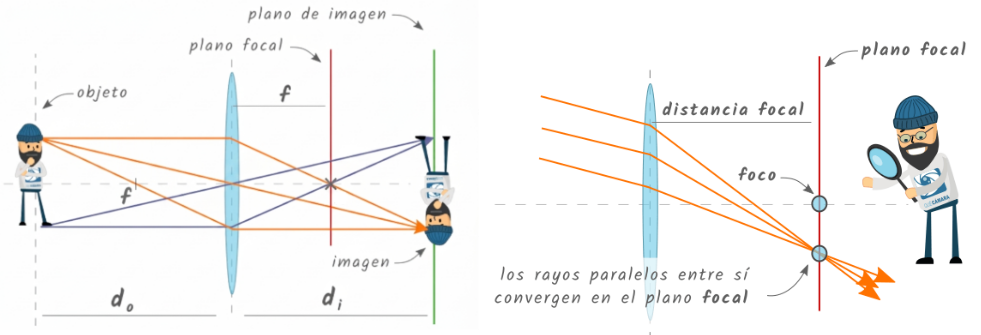
<!-- https://aprendiendofotografia.com/curso-basico/funcionamiento-de-una-lente-simple/ -->

<br><br><br><br><br><br><br><br><br>

[DESI: plano focal](https://www.desi.lbl.gov/education-outreach/interactive-visualizations/) 

---

[EUCLID ESA](https://www.youtube.com/watch?v=U60LhdfgDGk) 

[](https://www.youtube.com/watch?v=U60LhdfgDGk)

🎥 <https://www.youtube.com/watch?v=U60LhdfgDGk>

---

[JPAS CEFCA](https://www.youtube.com/watch?v=mxbKvzwxKRA) 

[](https://www.youtube.com/watch?v=mxbKvzwxKRA)

🎥 <https://www.youtube.com/watch?v=mxbKvzwxKRA>

---

# Cosmología en el aula

1. **La cosmología es accesible en secundaria:** No requiere cálculo avanzado; el álgebra básica y la física de ondas permiten abordar conceptos de vanguardia.
2. **Los datos reales están al alcance:** Plataformas como SDSS, Rubin EPO y Zooniverse democratizan la investigación en la escuela.
3. **El enfoque debe ser conceptual y empírico:** Confrontar activamente las misconcepciones mediante modelos analógicos y evidencia observacional.
4. **La Estructura a Gran Escala unifica la física:** Conecta el micro-mundo atómico con la macro-estructura del Universo.

---

# Actividades de Aula

1. *Línea de Tiempo Histórica: NASA Cosmic Times*
2. *Estudio de Supernovas y Energía Oscura con Rubin EPO*
3. *Exploración 3D de la Red Cósmica con JHU Interactive Map*
4. *Ciencia Ciudadana: Dark Energy Explorers (Zooniverse)*
5. *Análisis de Espectros Galácticos en SDSS Voyages*
6. *Simulación de Curvas de Rotación Galáctica*
7. *Juego de Cartas "Mapping the Cosmos"*
8. *Demostración del Efecto Doppler y Redshift con Teléfono y Sonido*

---

<!-- _class: compact -->

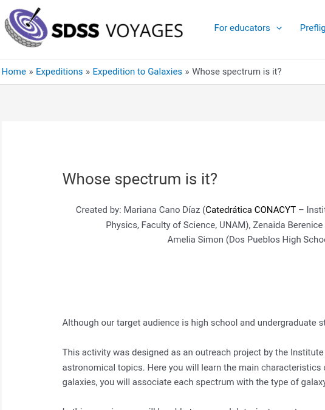

# Recursos Abiertos para Profesores

▶️ **SDSS Voyages & SkyServer** 

▶️ **Vera C. Rubin Observatory Education**

▶️ **NASA Cosmic Times** 

▶️ **Map of the Observable Universe (JHU)** 

▶️ **Dark Energy Explorers (Zooniverse)** 

▶️ **DESI High Curriculum**

---

<!-- _class: center -->

<style>
section.center {
  background-color: #976f4926 !important;
}
</style>

# ¡Muchas Gracias!

### *“Mi sospecha personal es que el Universo no sólo es más raro de lo que suponemos, sino más raro de lo que podemos suponer.”* — J.B.S. Haldane

**¿Preguntas, comentarios o experiencias didácticas para compartir?**

---

<!-- _class: compact -->
## Preconceptos y Errores Frecuentes 

| Dominio | Preconcepto Estudiantil | Causa Cognitiva |
| :--- | :--- | :--- |
| **Big Bang** | "Fue una explosión en el centro del espacio". | Reificación del espacio euclidiano. |
| **Expansión** | "Las galaxias se mueven por impulso propio". | Mecánica newtoniana clásica. |
| **Centro** | "La Vía Láctea está en el centro". | Sesgo egocéntrico en gráficos de Hubble. |
| **Escala** | "La expansión estira el Sistema Solar y los átomos". | Incomprensión de fuerzas competitivas. |


* **Error:** Considerar el Big Bang como una bomba que estalló en un lugar vacío preconcebido.

* **Pregunta del Estudiante:** *Si el Universo se expande, ¿por qué la Tierra o el Sistema Solar no se agrandan?*

---

<!-- Slide 51 -->
# Secuencia Didáctica

```
Semana 1: Escalas y Espectros
* Unidades cosmológicas (pc, al) y potencias de 10.
* Experimento de laboratorio con espectroscopía de tubos de descarga.
* Actividad: Doppler sonoro con smartphone.

Semana 2: Expansión de Hubble
* Demostración con banda elástica.
* Medición de z con datos reales de SDSS SkyServer.
* Construcción del Diagrama de Hubble y estimación de H0.

Semana 3: Componentes Oscuros y Red Cósmica
* Curvas de rotación galáctica y evidencia de materia oscura.
* Análisis de Supernovas Tipo Ia en Rubin EPO (Energía Oscura).
* Exploración interactiva del mapa 3D del Universo de JHU.

Semana 4: Síntesis y Proyectos
* NASA Cosmic Times.
* Participación en Dark Energy Explorers (Zooniverse).
* Evaluación diagnóstica con CosmoCI. 
```
<!-- https://link.springer.com/article/10.1007/s10763-022-10252-y -->

---

## 1️⃣ Actividad: Tamaño y Escala Cósmica

* **Objetivo:** Conceptualizar proporciones en el espacio.
* **Estrategía:**
  1. Construcción de una línea de tiempo y distancia a escala logarítmica en el patio escolar.
  2. Asignación de tarjetas de objetos (Tierra, Luna, Sol, Plutón, Próxima Centauri, Centro Galáctico, Andrómeda, Cúmulo de Virgo, CMB).
  3. Cálculo de tiempos de viaje de la luz para cada estación.

---

## 2️⃣ Actividad: Expansión Métrica con Banda Elástica

* **Objetivo:** Demostrar que el Universo no se expande desde un centro en el espacio.
* **Materiales:** Banda elástica ancha, marcador, regla.
* **Procedimiento:**
  1. Dibujar puntos (galaxias A, B, C, D) a distancias iguales de $2 \text{ cm}$.
  2. Estirar la banda elástica uniformemente.
  3. Medir la nueva separación desde la perspectiva de la Galaxia A y luego desde la Galaxia C.
* **Resultado:** Todas las galaxias ven a las demás alejarse con velocidades proporcionales a la distancia. **¡Sin centro preferente!**

---

## 3️⃣ Actividad: Diagrama de Hubble con SDSS SkyServer

* **Objetivo:** Reconstruir cuantitativamente la Ley de Hubble usando datos astronómicos profesionales (Revista Científica UD, 2016).
* **Consigna para Estudiantes:**
  1. Acceder al portal **SDSS SkyServer Navigate**.
  2. Seleccionar 5 galaxias a diferentes profundidades fotométricas.
  3. Extraer los espectros ópticos e identificar las líneas $H\alpha$ o Ca II K.
  4. Calcular $z$ y la velocidad $v = z \cdot c$.
  5. Graficar $v$ vs. $d$ (estimado por magnitud aparente) y obtener la pendiente $H_0$.

---

## 4️⃣ Actividad: NASA Cosmic Times 

* **Recurso:** NASA Goddard Space Flight Center.
* **Formato:** 6 afiches de periódicos históricos (1919, 1929, 1955, 1965, 1993, 2006).
* **Metodología en Aula:**
  * **Paso 1 (Gallery Walk):** Estudiantes recorren los afiches respondiendo preguntas abiertas sobre el desarrollo histórico.
  * **Paso 2 (Jigsaw):** Grupos de expertos analizan un año específico (confirmación de la Relatividad, descubrimiento de Hubble, CMB, Energía Oscura) y enseñan a sus pares.

---

## 5️⃣ Actividad: Investigaciones del Observatorio Rubin

* **Plataforma:** Rubin Observatory Education & Public Outreach (EPO).
* **Investigación:** *Universo en Expansión*.
* **Tarea Estudiantil:**
  1. Analizar curvas de luz fotométricas de Supernovas Tipo Ia reales.
  2. Medir la magnitud aparente en el máximo brillo.
  3. Construir diagramas de Hubble a altos redshifts ($z > 0.5$).
  4. Identificar la desviación respecto a una línea recta y concluir la presencia de **Energía Oscura**.

---

## 6️⃣ Actividad: Mapa Interactivo del Universo

* **Recurso:** *The Map of the Observable Universe*
* **Características:** Muestra 200000 galaxias medidas por el SDSS en un sector wedge de $10^\circ$.
* **Exploración en Clase:**
  * Visualización de la transición desde galaxias espirales azules cercanas, galaxias elípticas rojas, cuásares distantes hasta el límite del CMB.
  * Identificación directa de filamentos y vacíos en la estructura real.

---

## 7️⃣ Actividad: Ciencia Ciudadana - Dark Energy Explorers

* **Plataforma:** Zooniverse / Proyecto HETDEX (McDonald Observatory).
* **Involucrar estudiantes:**
  1. Los estudiantes analizan datos reales del espectrógrafo VIRUS.
  2. Identifican y clasifican objetos entre galaxias lejanas con emisión Lyman-alfa ($z \sim 2-3$) y galaxias cercanas con OIII.
  3. Contribuyen directamente a la investigación científica real sobre la naturaleza de la energía oscura.

---

## 8️⃣ Actividad: Redshift con Espectros Reales (SDSS Voyages)

* **Laboratorio Virtual:** SDSS Voyages (*Expedición a las Galaxias*).
* **Procedimiento:**
  * Abrir la herramienta *Explore Tool*.
  * Identificar las líneas de emisión/absorción conocidas ($\lambda_{\text{Rest}}$).
  * Determinar la longitud de onda desplazada ($\lambda_{\text{Obs}}$).
  * Aplicar la ecuación $z = (\lambda_{\text{Obs}} - \lambda_{\text{Rest}}) / \lambda_{\text{Rest}}$.
  * Calcular la velocidad de recesión de la galaxia.

---

<div style="position: absolute; top: 0; left: 0; width: 100%; height: 100%; display: flex; justify-content: center; align-items: center;">
  <iframe
    src="https://www.desmos.com/scientific"
    width="100%"
    height="100%"
    sandbox="allow-scripts allow-same-origin allow-forms allow-popups"
    referrerpolicy="no-referrer"
    loading="lazy"
    style="border: none; border-radius: 0; background: white;"
    allowfullscreen>
  </iframe>
</div>

<!-- 
https://flaviutamas.com/qalculate-wasm/
 -->
